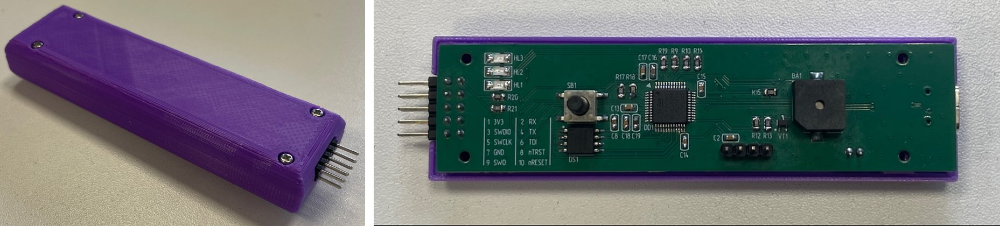
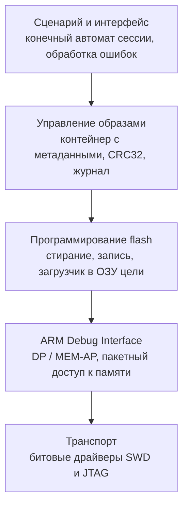
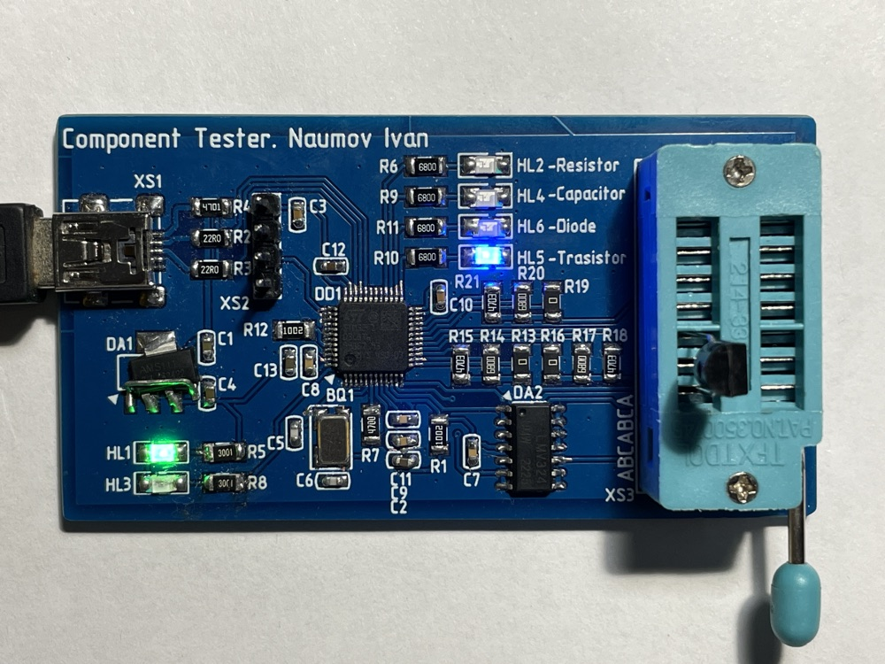
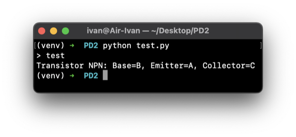
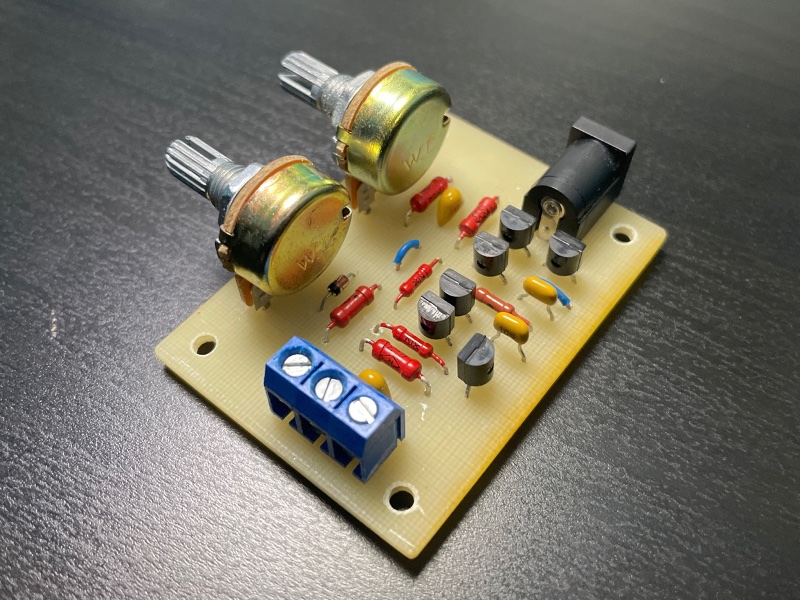
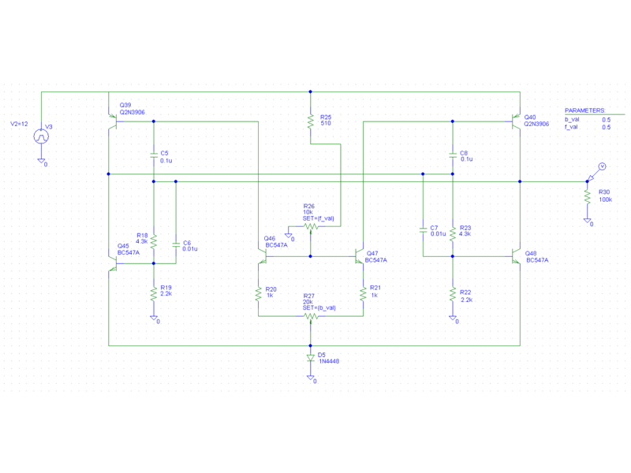

# Иван Наумов

**Embedded-разработчик · C/C++ · STM32 · FreeRTOS**
Делаю устройства целиком: схема, печатная плата, прошивка, тесты и CI

---

## Коротко

| | |
| --- | --- |
| 🔧 **Embedded** | ~3 года коммерческой разработки: мобильный робот, радиолокационные охранные датчики, зарядная инфраструктура для электромобилей |
| 📐 **Железо** | Схемотехника и печатные платы в Altium Designer, моделирование в PSpice, корпуса в Компас-3D, документация по ЕСКД |
| 📄 **Наука** | 2 статьи в Scopus / IEEE о беспроводных сетях LoRa и их энергопотреблении |
| 🎓 **Образование** | Бакалавриат МГТУ им. Н.Э. Баумана, магистратура НИУ ВШЭ (МИЭМ) «Интернет вещей и киберфизические системы» |
| 🐍 **Backend** | С 2022 года — CRM, Telegram/MAX-боты и сервисы автоматизации на Python/Django в продакшене, >50 пользователей |

---

## Опыт работы

### Гумич

**Инженер-программист микроконтроллеров** · 09.2025 — н.в. · робот «Городовой»

`STM32F4` `C++` `FreeRTOS` `CAN/CANopen` `HIL`

Колёсный робот для патрулирования и мониторинга территорий. Отвечаю за ПО микроконтроллеров: управление движением и безопасность.

- Разработал математическую модель кинематики робота и на её основе несколько режимов дистанционного управления.
- Сделал систему предотвращения столкновений: по данным ультразвуковых сонаров робот сам корректирует траекторию и скорость.
- Спроектировал отказоустойчивость: при потере связи или отказе датчиков робот переходит в безопасное состояние.
- Интегрировал прошивку с силовой электроникой и датчиками по CAN, RS485, UART и SPI. Настроил обмен с бортовым компьютером верхнего уровня по CANopen.
- Написал тестовое ПО для HIL-стенда: управление роботом автоматически проверяется по набору сценариев.
- Покрыл критичные модули юнит-тестами, пишу по MISRA C.

### Эволюция Заряда

**Разработчик встраиваемых систем** · 06.2025 — 07.2025 · балансировщик мощности зарядных станций

`ESP32` `FreeRTOS` `TCP/IP` `PSpice`

Устройство динамически распределяет доступную мощность между зарядными станциями электромобилей. Прототип выполнил все заданные функции.

- Прошивка для ESP32 (C, ESP-IDF, FreeRTOS): опрос датчиков тока через ADC + DMA, вывод на LCD по I2C.
- Веб-интерфейс управления по Wi-Fi и Ethernet.
- Аналоговая часть (моделирование в PSpice) и печатная плата, сборка и отладка макета.

### Стилсофт

**Программист встраиваемых систем** · 10.2023 — 03.2025 · охранные радары 24 ГГц

`Artery AT32 (Cortex-M4)` `CMSIS-DSP` `GitLab CI`

Прошивки для радиолокационных охранных извещателей 24 ГГц (ЛЧМ, эффект Доплера). Удалённо, в команде из 4+ разработчиков.

- Разрабатывал алгоритмы ЦОС: фильтрацию, детекцию событий, FFT. Прототипировал на Python (numpy, pandas, matplotlib), затем переносил на МК с CMSIS-DSP.
- Внедрил автоматическое тестирование прошивок в Docker и GitLab CI.
- Сделал CLI по UART для отладки и настройки датчиков без дополнительного оборудования.
- Спроектировал и собрал плату для PoE-стенда: схема, трассировка, монтаж, отладка.
- Участвовал в код-ревью.

### ГеоПлюс, СтройГеоКонтроль

**Python-разработчик (проектная работа)** · 01.2022 — 01.2025 · CRM, боты, LLM-сервис

`Python` `Django` `Celery` `Docker`

Автоматизирую процессы двух геодезических компаний. Подробности — в разделе [Backend и веб](#backend-и-веб).

---

## Проекты

**Embedded и электроника:** [Программатор JTAG/SWD](#-автономный-программатор-jtagswd) · [Тестер компонентов](#-тестер-радиокомпонентов) · [Генератор импульсов](#-генератор-прямоугольных-импульсов) · [Драйвер светильника](#-драйвер-светодиодного-светильника) · [Узел LoRa](#-узел-дозиметрического-контроля-на-lora)
**Backend:** [CRM](#-crm-геодезической-компании) · [Бот «Акт выноса границ»](#-бот-акт-выноса-границ) · [Генератор топопланов](#-генератор-топографических-планов) · [Мессенджер chatme](#-мессенджер-chatme)

## Embedded и электроника

### 🔌 Автономный программатор JTAG/SWD

`Диплом, «отлично» · 2026` `STM32L433` `C/C++` `SWD/JTAG` `USB MSC + CDC` `Altium`

Прошивает микроконтроллеры ARM Cortex-M **без ПК**: образы прошивок хранятся во внутренней памяти устройства. При подключении к компьютеру работает как стандартный отладочный зонд **CMSIS-DAP / DAPLink**. Обычно программатор — только транспорт, а определение целевого МК, выбор алгоритма записи и верификация выполняются на ПК. Здесь вся эта логика перенесена на STM32L433 с ограниченной ОЗУ.

**Сделал сам:** схему, печатную плату, корпус, ~15 тыс. строк прошивки и испытания.

Опытный образец: слева — устройство в корпусе, справа — плата без крышки (STM32L433, разъём JTAG/SWD, индикация, зуммер).

| Параметр | Значение |
| --- | --- |
| Интерфейсы к цели | SWD, JTAG (до 4 МГц), автоопределение МК по IDCODE |
| Интерфейс к ПК | USB Type-C: MSC (прошивки копируются как на флешку) + CDC / CMSIS-DAP |
| Хранение образов | Внешняя QSPI flash, контейнер с метаданными и CRC32 |
| Питание | Li-ion аккумулятор с контроллером заряда, ~211 мВт |
| Плата | 2 слоя, класс точности 4, дифференциальная пара USB 90 Ом |

<b>🧩 Архитектура ПО</b>

 

- **Стек SWD:** пакеты запросов с контролем чётности, обработка ACK/WAIT/FAULT, восстановление после ошибок (line reset, переключение JTAG-to-SWD), отложенное чтение через RDBUFF.
- **Стек JTAG:** обход автомата TAP, сканирование IR/DR, чтение IDCODE. Подключённый МК определяется автоматически по таблице сигнатур.
- **Семейства МК описываются декларативно:** карта памяти, размер страницы и регистры контроллера flash. Новое семейство добавляется без правки ядра.
- **Надёжность:** без динамического выделения памяти в критических путях. Контрольная сумма контейнера проверяется до начала сессии, после записи — CRC32.
- **Тестирование:** верхние уровни покрыты модульными тестами на хосте с заглушкой транспорта, полный цикл регрессионно прогоняется на аппаратном стенде.

<b>📷 Плата, 3D-модель, корпус и готовое устройство</b>

#### Печатная плата

#### 3D-вид

#### Корпус

Корпус состоит из двух деталей: основания и крышки. В основание при производстве впаиваются резьбовые втулки и световоды. Выполнены тепловой расчёт и анализ вибропрочности платы.

#### Опытный образец

---

### 🧪 Тестер радиокомпонентов

`Курсовой проект · 2025` `STM32F103` `C` `Catch2` `Altium` · Код: [component_tester](https://github.com/IvanNaum/component_tester)

Определяет, какой компонент подключён (резистор, конденсатор, диод или транзистор), и измеряет его параметры. Тип компонента показывает светодиодами на плате, а команды и результаты измерений передаёт через виртуальный COM-порт по USB.

- Каждый из измерительных выводов программно переключается между резисторами разного номинала и входом АЦП, поэтому один и тот же тракт подходит для разных компонентов и диапазонов.
- Консоль, команды и логика тестера вынесены в общий модуль, который собирается и под МК, и на хосте; на хосте он покрыт юнит-тестами (Catch2).
- Схема, печатная плата и комплект документации по ЕСКД.

 

Слева — плата тестера: в панель установлен транзистор, тестер определил его тип и зажёг индикатор «Transistor». Справа — результат в консоли по USB: структура NPN и назначение выводов.

---

### 〰️ Генератор прямоугольных импульсов

`Курсовая работа · 2024` `PSpice` `Altium` `Компас-3D` · Код и документация: [pwm_generator](https://github.com/IvanNaum/pwm_generator)

Аналоговый генератор с регулировкой частоты (до 1 кГц) и скважности (от 2 до 5). Прошёл полный цикл: схема → моделирование → плата → сборка → измерения на осциллографе.

 

Слева — собранное устройство на односторонней плате 60×45 мм, справа — модель в PSpice.

---

### 💡 Драйвер светодиодного светильника

`2026` `STM32G030` `C` `таймеры` `EXTI`

Двухканальный драйвер на AL8860 для тёплого и холодного света. Всё управление — одним энкодером с кнопкой.

- ШИМ двух каналов на синхронизированных таймерах TIM1 и TIM3.
- Энкодер и кнопка обрабатываются в прерываниях EXTI с антидребезгом.

---

### 📡 Узел дозиметрического контроля на LoRa

`НИР · 2025–2026` `STM32` `LoRa E22-900T22D` `2 статьи в IEEE`

Прототип беспроводного узла для распределённой системы радиационного мониторинга с питанием от аккумулятора. Измерил дальность связи (до 600 м в городе и до 3,3 км на открытой местности) и сравнил LoRa с Wi-Fi, Bluetooth и ZigBee по дальности и энергопотреблению. Результаты опубликованы в двух статьях, см. [Публикации](#публикации-и-награды).

---

## Backend и веб

Код коммерческих проектов закрыт и принадлежит заказчикам. Архитектуру и фрагменты могу показать на собеседовании.

### 🗂 CRM геодезической компании

`ГеоПлюс` `в продакшене с 2022` `>50 пользователей` `Django` `PostgreSQL` `Docker Compose` `nginx`

Рабочая система компании: учёт заказов, сотрудников и финансов, импорт данных, роли и права доступа. Развёрнута в Docker за nginx с HTTPS (Let's Encrypt).

### 📄 Бот «Акт выноса границ»

`СтройГеоКонтроль, ГеоПлюс` `Python` `Telegram Bot API` `MAX Bot API` `python-docx`

Из файлов с координатами (XML, GeoJSON) собирает готовый акт в DOCX и PDF со схемой участка. Логика сценария не зависит от мессенджера: один сценарий работает и в Telegram, и в MAX. Для MAX написан собственный клиент Bot API.

### 🗺 Генератор топографических планов

`СтройГеоКонтроль` `в разработке` `Django` `Celery` `Redis` `ezdxf` `LLM` `mypy --strict`

Превращает точки полевой съёмки в чертёж инженерно-топографического плана (DXF/PDF). Правки в чертёж вносятся через чат на естественном языке с помощью LLM. Строгая типизация, тесты и автодеплой на сервер при каждом слиянии в main.

### 💬 Мессенджер chatme

`VK Education · 2024` `тимлид` `JavaScript` `Go` `WebSocket` `PostgreSQL` · Код: [frontend](https://github.com/frontend-park-mail-ru/2024_1_commandName) · [backend](https://github.com/go-park-mail-ru/2024_1_commandName)

Командный проект: веб-мессенджер с чатами в реальном времени. Был **тимлидом** команды из 4 человек и разрабатывал frontend.

<b>Боты поменьше</b>

 

| Проект | Заказчик | Что делает | Стек |
| --- | --- | --- | --- |
| **Платёжный бот** | ГеоПлюс | Выставляет счета через эквайринг Modulbank прямо из Telegram и отслеживает оплату | Python, Telegram Bot API, REST API |
| **Бот скалодрома ЦСКА** | Скалодром ЦСКА | Запись на тренировки с уведомлением администраторов | Python, python-telegram-bot |

---

## Небольшие проекты и тестовые задания

| Проект | Что это | Стек | Код |
| --- | --- | --- | --- |
| **Генератор и частотомер на регистрах** | Тестовое задание без CubeMX: FreeRTOS, UART через кольцевой буфер, генератор и измеритель частоты на таймерах | STM32, C, CMSIS, FreeRTOS | [pwm_freq_meter](https://github.com/IvanNaum/pwm_freq_meter) |
| **Блочный аллокатор памяти** | Тестовое задание: потокобезопасный аллокатор фиксированных блоков из статического пула для embedded-платформ разной разрядности, с юнит-тестами | C, C++, CMake | [block_allocator](https://github.com/IvanNaum/block_allocator) |
| **Светильник с индикатором** | Прошивка LED-светильника с семисегментным индикатором | STM32G030, C | [luminaire_stm32](https://github.com/IvanNaum/luminaire_stm32) |
| **IoT-практикум НИУ ВШЭ** | 14 лабораторных: кодовый замок, Modbus, многозадачность, умная лампа на MQTT, экомониторинг в Node-RED, дашборды в Grafana | ESP32, STM32, MQTT, Modbus, Node-RED, Grafana | — |
| **Расширение для расписания МГТУ** | Chrome-расширение: выгружает расписание в календарь в формате ICS | JavaScript | [bmstu_shedule_ics](https://github.com/IvanNaum/bmstu_shedule_ics) |

---

## Стек

| Область | Технологии |
| --- | --- |
| **МК и ОС** | STM32 (F1, F4, G0, L4; HAL/LL, CubeMX, регистры), Artery AT32, ESP32 (ESP-IDF), FreeRTOS, Zephyr |
| **Интерфейсы** | CAN, CANopen, RS485, Modbus, UART, SPI, I2C, USB (MSC, CDC), Ethernet, Wi-Fi, LwIP, TCP/IP, JTAG/SWD, LoRa, MQTT |
| **Алгоритмы** | ЦОС (фильтры, FFT, CMSIS-DSP), ПИД-регуляторы, фильтр Калмана, кинематика мобильных роботов |
| **Качество** | Юнит-тесты (Catch2), HIL-стенды, MISRA C, code review, CI в Docker и GitLab CI |
| **Инструменты** | CMake, GCC ARM, Keil, IAR, SEGGER Embedded Studio, OpenOCD, J-Link, осциллограф, логический анализатор, CAN-анализатор, Wireshark |
| **Железо** | Altium Designer, KiCad, PSpice, Компас-3D, ЕСКД |
| **Backend** | Python, Django, Celery, PostgreSQL, Redis, Docker Compose, nginx, CI/CD, Linux, Bash |

---

## Публикации и награды

- **Methods and Models of Data Transmission for Ionizing Radiation Registration Systems** — SmartIndustryCon 2026, IEEE. [IEEE Xplore](https://ieeexplore.ieee.org/document/11493029) · DOI: 10.1109/SmartIndustryCon68821.2026.11493029
- **Energy-Efficient Internet of Things Technology Networks Based on the LoRa Communication Module** — ICIEAM 2025, IEEE. [IEEE Xplore](https://ieeexplore.ieee.org/document/11028346) · DOI: 10.1109/ICIEAM65163.2025.11028346

## Образование

- **НИУ ВШЭ, МИЭМ** — магистратура «Интернет вещей и киберфизические системы», 2026–2028
- **МГТУ им. Н.Э. Баумана, ИУ4** — бакалавриат «Конструирование и технология электронных средств», 2026
- **VK Education** — образовательная программа VK: алгоритмы, проектирование систем, веб-разработка, Go, 2023–2024
- **МГТУ им. Н.Э. Баумана** — профессиональная переподготовка «Инженер-разработчик встраиваемых систем», 422 ч, 2025

---

Открыт к предложениям в гражданских проектах на стыке софта и железа · [Telegram](https://t.me/ivan_naum)

